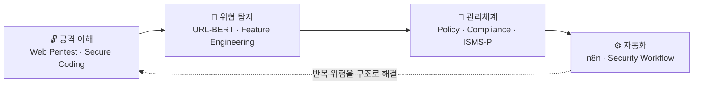
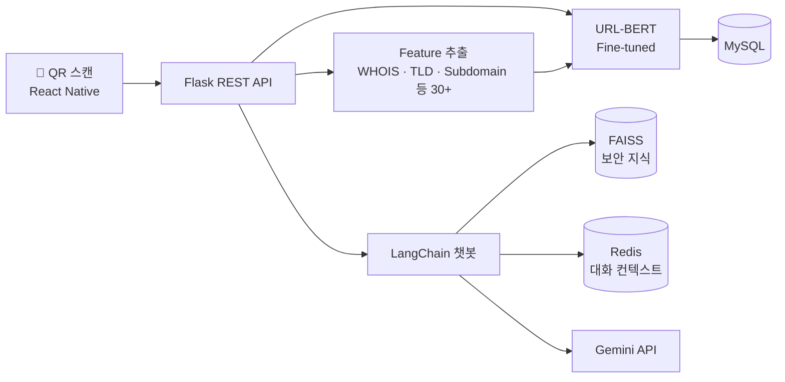

<!-- Header -->

  

<h3 align="center">🛡️ 반복되는 문제의 원인을 구조에서 찾습니다</h3>

  

---

## 🙋 About Me

**공격을 이해하고, 위협을 탐지하고, 반복되는 위험을 기준과 자동화로 해결합니다.**

- 🏢 BMW Korea IT 부서 인턴: 반복 취약점의 원인을 찾아 **대응 가이드로 정비**하고 점검·리포팅 업무를 **자동화**
- 🔓 취약한 웹 서버를 직접 구축·공격하고 **시큐어 코딩으로 조치**해 본 경험
- 🤖 URL 특화 언어모델 URLBERT를 파인튜닝해 큐싱(QR 피싱) URL을 **정확도 99.64%** 로 탐지
- 🏆 과학기술대학 학술제 **최우수상** · BMW Korea 사내 AI 해커톤 **2위**
- 🔍 관심 분야: **정보보호 관리체계(ISMS-P)** · 웹 취약점 진단 · AI 기반 위협 탐지 · 보안 자동화

---

## 💼 Experience

### 🏢 BMW Korea · IT 부서 인턴
`2026.01 ~ 2026.06`

- **소스코드 취약점 대응 가이드**: GHAS에 반복 등록되는 취약점의 원인(팀별 조치 방식 차이)을 확인하고 가이드를 건의·제작, 재등록 빈도 감소 및 사내 자료로 활용
- **정보보호 관리 지원**: 국가별 법인 보안 KPI 모니터링, 컨설팅 개선과제 이행 증적 검토, 개인정보보호법·신용정보법·ISMS-P 개정 동향 월간 정리
- **업무 자동화**: Jira QC 리포팅을 n8n으로 자동화해 하루 걸리던 작업을 1시간 이내로 단축, 점검 후속조치 티켓 자동 생성 구조 기획·구현

### 🥈 BMW Korea 사내 AI 해커톤 2위
`2026` · 3인 팀 · 기술 구현 담당

- 일정·부서 간 요청·예산 처리가 여러 채널에 흩어져 있던 문제를 정의
- n8n 기능별 에이전트와 자연어 라우팅으로 하나의 업무 창구 구현, 사내 업무에 실제 적용

---

## 🛠️ Tech Stack

**🔐 Security** 

**💻 Backend & Mobile** 

**🤖 AI & Automation** 

**☁️ Infra & DB** 

---

## 📌 Featured Projects

<table>
<tr>
<td width="50%" valign="top">

### 🔍 [SQanaR](https://github.com/dlwl224/sqanar-quishing-detector)
**URL-BERT 기반 큐싱(QR 피싱) 탐지 앱** 
`2025.03 ~ 2025.11` · 팀 · AI 모델·백엔드

- URLBERT 도입, URL+Header 10만 건으로 파인튜닝
- **Accuracy / F1 99.64%** (XGBoost 95.99%, BERT 94.03%)
- WHOIS·TLD·Subdomain 등 30+ Feature 파이프라인
- 블랙리스트에 없는 **제로데이 URL** 탐지
- LangChain + FAISS 보안 지식 챗봇
- 🏆 과학기술대학 학술제 **최우수상**

`PyTorch` `Flask` `LangChain` `FAISS` `Redis`

</td>
<td width="50%" valign="top">

### 🔓 [Web Pentest & Secure Coding](https://github.com/dlwl224/web-vuln-pentest-lab)
**취약한 웹앱 구축 → 모의해킹 → 조치** 
`2025.11` · 개인 · 기여도 100%

| 취약점 | 조치 |
| :--- | :--- |
| SQL Injection | Prepared Statement |
| Stored XSS | HTML Entity Encoding |
| IDOR | 세션 기반 소유권 검증 |
| File Upload | 화이트리스트 · 파일명 난수화 |

- AWS EC2 배포, Security Group 접근 제한

`Node.js` `MySQL` `Burp Suite` `AWS EC2`

</td>
</tr>
<tr>
<td width="50%" valign="top">

### 🧳 [뚜르](https://github.com/ddu-ru/ddu-ru-android)
**여행 성향 매칭 동행 앱** 
`2025.11 ~ 진행 중` · 8인 팀 · Android

- 채팅 목록·요청함·신청내역·채팅방 구현, WebSocket 연결·읽음 처리
- 채팅 오류 시 **서버 응답 원문 대신 상태별로 정해진 문구만 표시**하도록 수정
- 마이페이지(프로필 수정·탈퇴·차단 목록·고객센터) 구현 및 API 연결
- 온보딩 설문 API 연결, 전화번호 인증·닉네임 오류 문구 처리
- 디자인 시스템(Color·Type·Theme) 구조 설정

`Kotlin` `Jetpack Compose` `WebSocket`

</td>
<td width="50%" valign="top">

### 💰 FINDEPENDENCE
**첫 독립 청년 금융자립 진단 AI** 
`2026.07 ~ 2026.09` · 팀 · RAG 담당 · 2026 금융 AI Challenge

- 공공 통계(주거실태조사·청년 삶 실태조사) 임베딩, 벡터 DB 구축
- 근거 문서를 공공 통계로 한정해 답변 출처 검증 가능
- RAG를 별도 컨테이너로 분리해 서비스와 통합
- 예선 MVP 제출

`Qwen3-Embedding` `Chroma DB` `Gemini API` `Docker` `AWS EC2`

</td>
</tr>
</table>

<b>🗺️ SQanaR 시스템 구성도 보기</b>

 

### 🎣 NH농협 AI 아이디어 챌린지 — 보이스피싱 예방 시스템
`2025.09 ~ 2025.11` · 3인 팀 · 팀장 · **1차 예선 통과**
- 금감원·경찰청 자료와 뉴스로 수법 10개를 4개 유형으로 재분류, 시나리오 2개 작성
- FDS · 심리 AI · 연관성 AI의 3계층 구조 설계

### 🌲 [구독숲](https://github.com/SubscriptionForest) — 인증 보안 구현
`2025.07 ~ 2025.08` · 팀 · Full-stack
- Spring Security + **JWT** 인증, 로그아웃 시 **토큰 블랙리스트** 처리로 탈취 토큰 재사용 차단

`Spring Boot` `Spring Security` `JWT`

---

## 📜 Certifications

| 자격증 · 어학 | 취득 |
| :--- | :--- |
| OPIc IH | 2026.03 |
| SQLD | 2025.12 |
| 정보처리기사 | 2025.09 |
| 리눅스마스터 2급 | 2025.07 |
| 新HSK 5급 | 2025.04 |

---

## 📚 Security Activities

- 🏛️ **KISA 교육** — 인프라와 웹의 주요 위협 기술(2026.11, 수료) · K-Shield 주니어 기초과정(2026.10)
- 🛡️ **보안동아리 '백도어'** — 제로트러스트 아키텍처 · 디지털 포렌식 스터디 및 세미나 발표
- 🕸️ **웹해킹 실습** — OWASP Top 10 중심 취약점 분석, DVWA 필터링 우회 실습
- ☕ **솔데스크 국비교육** — 1,040시간, Spring Boot REST API · CI/CD · ERD·MVC 설계

---

## 📊 GitHub Stats

  
  

<!-- Footer -->

  

